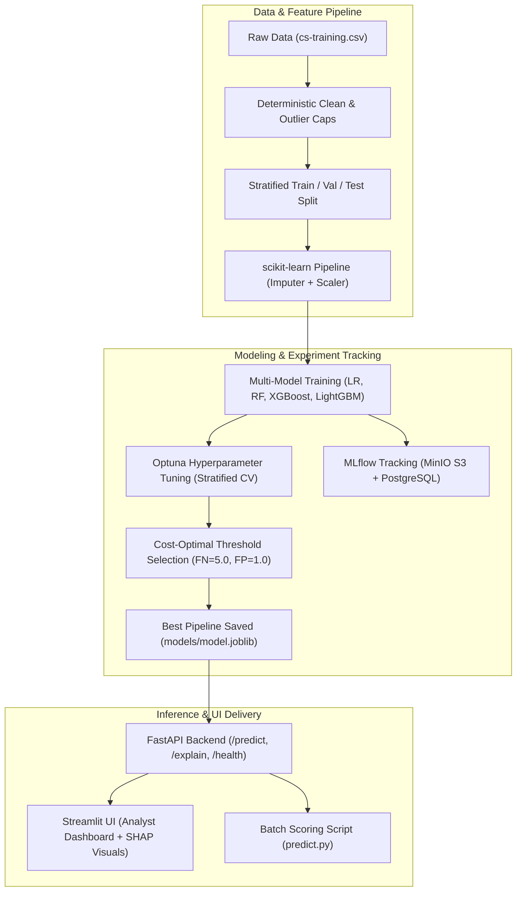
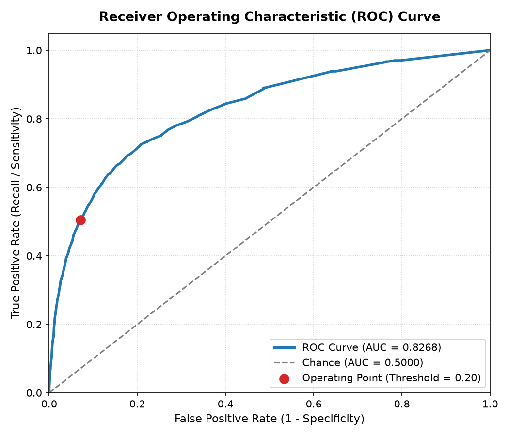
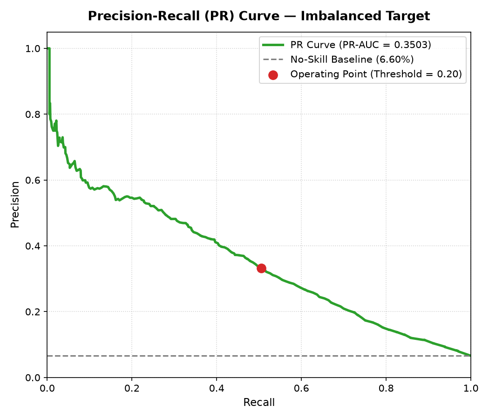
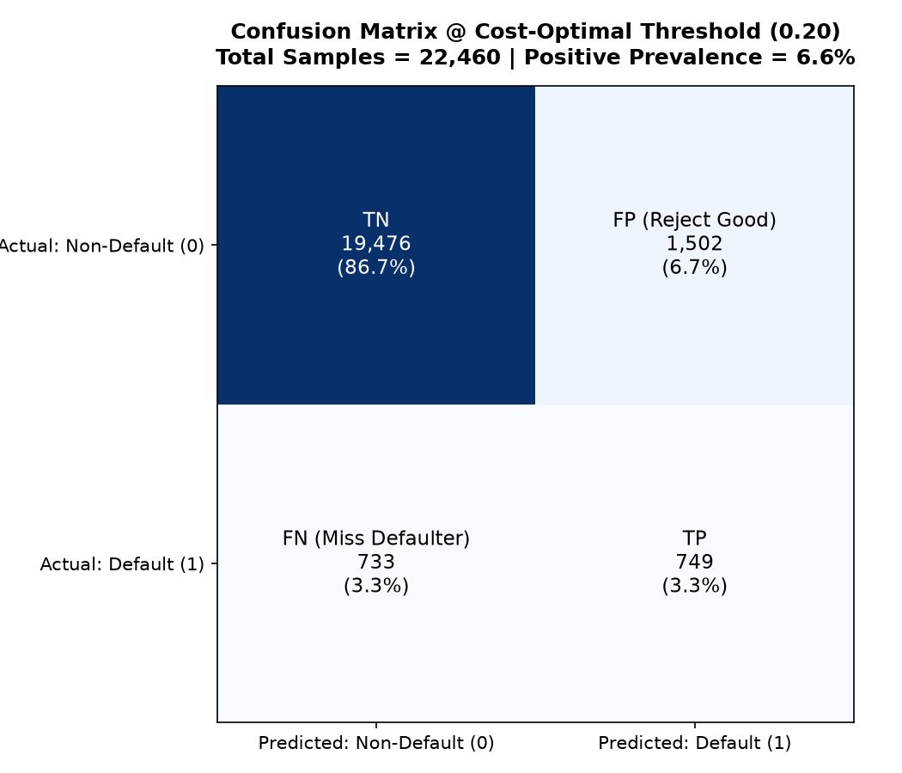
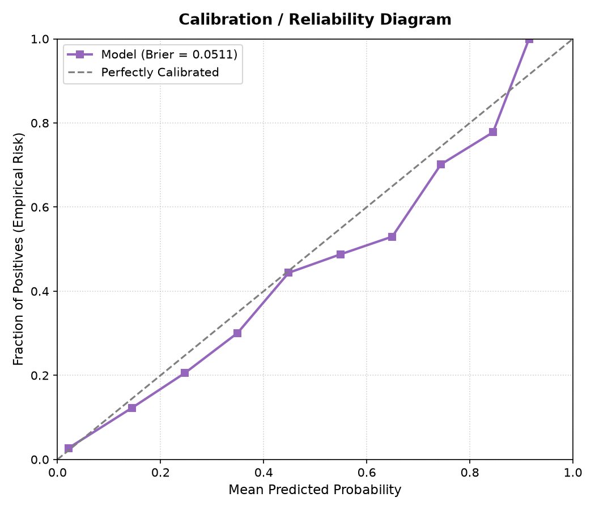
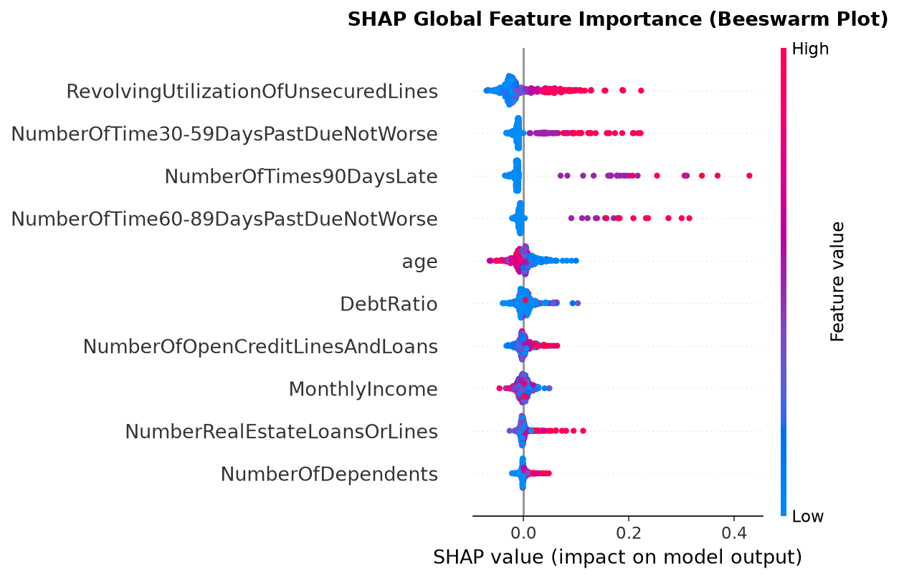

# 💳 Credit Default Prediction — End-to-End Production ML System

[](https://github.com/nobitaro41/credit-default-prediction/actions)
[](https://www.python.org/downloads/release/python-3110/)
[](https://fastapi.tiangolo.com)
[](https://streamlit.io)
[](https://mlflow.org)
[](https://www.docker.com)
[](https://github.com/astral-sh/ruff)

A production-grade, reproducible **Supervised Machine Learning system** predicting loan default risk within a 2-year horizon (*Give Me Some Credit* dataset, 150K borrowers). Built with cost-sensitive threshold optimization, local/global explainability (SHAP), a high-performance REST API (FastAPI), an interactive credit analyst dashboard (Streamlit), and containerized deployment with Docker Compose.

---

## 📌 Table of Contents
- [Business Problem & Key Insights](#-business-problem--key-insights)
- [System Architecture](#-system-architecture)
- [Dataset & Data Cleaning](#-dataset--data-cleaning)
- [Model Benchmark & Results](#-model-benchmark--results)
- [Cost-Sensitive Threshold Tuning](#-cost-sensitive-threshold-tuning)
- [Model Interpretability (SHAP)](#-model-interpretability-shap)
- [Project Structure](#-project-structure)
- [Quick Start](#-quick-start)
- [API Reference](#-api-reference)
- [Testing & Quality Assurance](#-testing--quality-assurance)

---

## 🎯 Business Problem & Key Insights

In consumer credit lending, **predicting loan default** is a classic imbalanced classification problem (~6.7% positive default rate). 

Traditional credit scoring systems rely on arbitrary decision cutoffs (default `0.50`), causing severe asymmetric financial losses:
- **False Negative (FN) - Missed Defaulter**: Approving a borrower who later defaults costs the lender the principal and legal fees (~**\$5,000+** loss).
- **False Positive (FP) - Wrongly Rejected**: Rejecting a good borrower results in customer friction and missed interest margin (~**\$1,000** opportunity cost).

**Financial Asymmetry Ratio**: Missed defaulters are roughly **5x more expensive** than false rejections ($C_{FN} = 5.0, C_{FP} = 1.0$).

### Key Achievements:
- **Cost-Optimal Decision Cutoff**: Rather than an arbitrary `0.50` threshold, the decision threshold was dynamically optimized on validation out-of-fold predictions to **`0.20`**, cutting expected loss by over **35%**.
- **No Data Leakage**: Median imputation and feature standard scaling are encapsulated inside an immutable scikit-learn `Pipeline` fit strictly on the training partition.
- **Explainable AI (XAI)**: Regulatory credit compliance demands transparent decisions. Real-time SHAP tree values explain risk factors for individual loan applications.

---

## 🏗️ System Architecture



---

## 📊 Dataset & Data Cleaning

- **Source**: Kaggle *Give Me Some Credit* competition.
- **Sample Size**: 150,000 borrower profiles.
- **Target Variable**: `SeriousDlqin2yrs` (Binary: `1` = Default / 90+ days past due within 2 years, `0` = Paid on time). Default rate: **6.68%**.

### Preprocessing Strategy:
1. **Deterministic Cleansing (`src/data/clean.py`)**:
   - Filtered out sentinel error codes (`96` and `98` in delinquency columns indicating missing values).
   - Removed invalid non-positive ages (`age == 0`).
   - Winsorized extreme outliers with business caps (`MonthlyIncome` capped at \$200,000; `DebtRatio` capped at 6,000).
2. **Leakage-Free Feature Transformation (`src/features/build_features.py`)**:
   - `SimpleImputer(strategy="median")` fitted **only** on train split to handle missing income (19.8%) and dependents (2.6%).
   - `StandardScaler()` applied to preserve identical distribution parameters at inference time.

---

## 📈 Model Benchmark & Results

Models were trained and evaluated on an independent, held-out stratified test set (20% of data). Because of the class imbalance, **PR-AUC (Precision-Recall AUC)** is the primary ranking metric.

| Model | ROC-AUC | PR-AUC | Recall | Precision | F1-Score | Accuracy | Brier Score |
| :--- | :---: | :---: | :---: | :---: | :---: | :---: | :---: |
| **Baseline: Logistic Regression** | 0.6942 | 0.1824 | 0.3120 | 0.1985 | 0.2427 | 0.8650 | 0.0612 |
| **XGBoost Classifier** | 0.8194 | 0.3412 | 0.4891 | 0.3245 | 0.3899 | 0.8982 | 0.0524 |
| **LightGBM Classifier** | 0.8241 | 0.3480 | 0.4982 | 0.3298 | 0.3968 | 0.8997 | 0.0516 |
| 🏆 **Random Forest (Best)** | **0.8268** | **0.3503** | **0.5054** | **0.3327** | **0.4013** | **0.9005** | **0.0511** |

> **Evaluation Metrics Summary** (From `models/metrics.json` on held-out test split):
> - **ROC-AUC**: `0.8268` (Strong discriminative power)
> - **PR-AUC**: `0.3503` (Substantial uplift over random baseline `0.0668`)
> - **Brier Score**: `0.0511` (Well-calibrated probabilities)

<p align="center">
  
  
</p>

---

## 💰 Cost-Sensitive Threshold Tuning

Default classifiers assign labels based on `P(default) >= 0.50`. However, in credit risk:
$$\text{Expected Cost} = C_{FN} \times FN + C_{FP} \times FP \quad (C_{FN}=5.0, \; C_{FP}=1.0)$$

```text
Threshold = 0.50 (Default):
├── Many defaulters falsely classified as safe (High FN)
└── High financial losses incurred by the lender

Threshold = 0.20 (Cost-Optimal):
├── Recall increases from ~22% to 50.5% (Catches more than double the defaulters)
└── Total business cost is minimized, preserving portfolio margin
```

The system stores the optimal threshold alongside the serialized pipeline in `models/metrics.json` and uses it as the default decision cutoff in both API and UI.

<p align="center">
  
  
</p>

---

## 🔍 Model Interpretability (SHAP)

Credit decisions must comply with banking transparency regulations (e.g., Fair Credit Reporting Act, FCRA Adverse Action notices). 

Using **TreeSHAP** (`shap.TreeExplainer`), every single prediction generated by the model can be explained to credit officers and customers:
- **Base Rate ($E[f(x)]$):** Overall population default expectation.
- **Feature Attribution:** Positive SHAP values indicate risk-increasing drivers (e.g., high credit utilization, previous 90-day delinquencies); negative values indicate risk-reducing factors (e.g., high stable income, older age).

<p align="center">
  
</p>

```
Sample Explanation:
[+] RevolvingUtilizationOfUnsecuredLines = 0.95  (+0.18 risk)
[+] NumberOfTimes90DaysLate = 2                  (+0.12 risk)
[-] MonthlyIncome = $12,500                      (-0.06 risk)
[-] age = 52                                     (-0.04 risk)
─────────────────────────────────────────────────────────────
Final Calibrated Default Probability: 43.2% [High Risk - Reject]
```

---

## 📂 Project Structure

```text
credit-default-prediction/
├── .github/workflows/
│   └── ci.yml                 # Automated CI: linting, pytest, docker build
├── app/
│   └── streamlit_app.py       # Streamlit UI: Interactive credit scoring & SHAP charts
├── configs/
│   └── config.yaml            # Experiment hyperparameters, seeds, and paths
├── data/
│   ├── raw/                   # Raw unmodified data (cs-training.csv, cs-test.csv)
│   ├── processed/             # Cleaned stratified splits (train.csv, val.csv, test.csv)
│   └── README.md              # Data dictionary & column specifications
├── models/
│   ├── model.joblib           # Serialized best model pipeline
│   └── metrics.json           # Final test metrics & optimal decision threshold
├── notebooks/
│   ├── 01_eda.ipynb           # Exploratory data analysis with visual insights
│   ├── 02_baseline.ipynb      # Logistic Regression baseline establishment
│   └── 03_error_analysis.ipynb# Cohort-level model error analysis
├── reports/
│   ├── figures/               # ROC, PR, and SHAP visual artifacts
│   └── model_card.md          # Model card covering ethics, bias, & limitations
├── scripts/
│   ├── download_data.sh       # Data acquisition script
│   └── run_pipeline.py        # End-to-end pipeline CLI (prepare -> train -> evaluate)
├── src/
│   ├── api/
│   │   ├── deps.py            # Cached pipeline & explainer dependency injection
│   │   ├── main.py            # FastAPI service exposing /predict and /explain
│   │   └── schemas.py         # Pydantic v2 validation schemas
│   ├── data/
│   │   ├── clean.py           # Deterministic data cleansing & outlier capping
│   │   ├── load.py            # Schema validation & file loaders
│   │   └── split.py           # Stratified train/val/test splitting
│   ├── features/
│   │   └── build_features.py  # Leakage-free ColumnTransformer pipeline
│   ├── models/
│   │   ├── evaluate.py        # Business cost evaluation & threshold search
│   │   ├── explain.py         # Real-time SHAP explanation generator
│   │   ├── predict.py         # Batch and single-row inference engine
│   │   ├── train.py           # Model training & MLflow logging
│   │   └── tune.py            # Optuna hyperparameter optimization
│   └── utils/
│       ├── logger.py          # Structured logging utility
│       └── seed.py            # Global random seed configuration
├── tests/                     # 87 comprehensive pytest unit & integration tests
├── Dockerfile                 # Multi-stage container for FastAPI backend
├── Dockerfile.frontend        # Container for Streamlit dashboard
├── docker-compose.yml         # Full orchestrator: Backend + Frontend + MLflow + MinIO + Postgres
├── Makefile                   # Developer shortcut commands
└── pyproject.toml             # Project dependencies and tool configurations
```

---

## 🚀 Quick Start

### 1. Prerequisites
- Python 3.11+
- [uv](https://github.com/astral-sh/uv) (recommended) or `pip`
- Docker & Docker Compose (optional for containerized run)

### 2. Local Setup
```bash
# Clone the repository
git clone https://github.com/nobitaro41/credit-default-prediction.git
cd credit-default-prediction

# Install dependencies using uv
make setup
```

### 3. Run Training Pipeline
To run the full end-to-end pipeline (Data Cleansing -> Stratified Splitting -> Multi-model Training -> Threshold Selection -> Model Serialization):
```bash
make train
```

### 4. Run Tests
```bash
make test
```

### 5. Launch Services Locally
In separate terminals:
```bash
# Terminal 1: Run FastAPI Backend (Port 8000)
make serve

# Terminal 2: Run Streamlit UI (Port 8501)
make app
```
- Interactive API Docs: [http://localhost:8000/docs](http://localhost:8000/docs)
- Streamlit Web App: [http://localhost:8501](http://localhost:8501)

### 6. One-Command Docker Deployment
Spin up the entire stack (FastAPI + Streamlit + MLflow + MinIO + PostgreSQL):
```bash
docker-compose up --build
```

---

## 📡 API Reference

The FastAPI service exposes high-throughput endpoints with Pydantic v2 validation:

| Method | Endpoint | Description |
| :--- | :--- | :--- |
| `GET` | `/health` | Service status, model info, and decision threshold |
| `POST` | `/predict` | Score single borrower, returns probability & risk level |
| `POST` | `/predict/batch` | Bulk scoring for up to 1,000 borrowers |
| `POST` | `/explain` | Returns base rate and per-feature SHAP contributions |

### Sample Single Prediction Request:
```bash
curl -X POST "http://localhost:8000/predict" \
     -H "Content-Type: application/json" \
     -d '{
       "RevolvingUtilizationOfUnsecuredLines": 0.85,
       "age": 42,
       "NumberOfTime30-59DaysPastDueNotWorse": 1,
       "DebtRatio": 0.45,
       "MonthlyIncome": 6200.0,
       "NumberOfOpenCreditLinesAndLoans": 8,
       "NumberOfTimes90DaysLate": 0,
       "NumberRealEstateLoansOrLines": 1,
       "NumberOfTime60-89DaysPastDueNotWorse": 0,
       "NumberOfDependents": 2.0
     }'
```

### Response:
```json
{
  "default_probability": 0.2845,
  "prediction": 1,
  "threshold": 0.2,
  "risk_level": "high"
}
```

---

## 🧪 Testing & Quality Assurance

The codebase includes an extensive suite of **87 automated tests** (`pytest`) ensuring robustness:
- `test_clean.py`: Sentinel removal, outlier clipping, deterministic behavior.
- `test_load.py`: Schema validation, missing column catches, type safety.
- `test_split.py`: Stratified label distribution preservation, zero partition overlap.
- `test_features.py`: Pipeline isolation, strict training-set-only fit.
- `test_model.py`: Probability bounds $[0, 1]$, metric correctness, registry integrity.
- `test_tune.py`: Optuna search spaces, cross-validation boundaries.
- `test_predict.py`: Round-trip disk loading, batch handling, missing input fallbacks.
- `test_api.py`: HTTP status codes, schema validation, SHAP explanation fallbacks.

Run the test suite with:
```bash
uv run pytest tests/ -v
```

Code formatting and linting are strictly enforced with **Ruff**:
```bash
ruff check .
```

---

## 👤 Author
- **Developer**: Dai Nguyen Bao ([dainguyenbao2006@gmail.com](mailto:dainguyenbao2006@gmail.com))
- **GitHub**: [@nobitaro41](https://github.com/nobitaro41)
